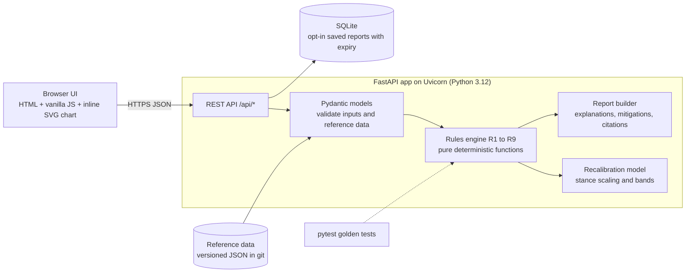

# Bionic Passport: Build and Defense Plan

Hackathon: Beyond 2030 (IEEE Lumen 2.0). Plan date: 2026-10-25.

**Build status:** built and tested (29 tests pass). Run `run.bat`. See `README.md` for the submission summary. The demo script in section 10.1 matches the built app.

**Inputs and assumptions about this plan**
- The specification book was not in the project folder. This plan follows the rules quoted in the brief.
- The team-skill and time placeholders were not filled in. Assumed: strongest in Python, some JavaScript, 8 hours to the pitch.
- Evidence tags used everywhere:
  - **[F]** Established fact. A primary measurement, a standard's text, or a manufacturer's instructions for use (IFU).
  - **[E]** Published estimate or published interpretation.
  - **[A]** Our modeling assumption. The reasoning is given.
  - **[VERIFY]** Not yet confirmed against the primary document. Someone on the team must check it before the pitch, or say it out loud as unverified.
- Source IDs such as (S01) point to section 15.

---

## 0. Framing corrections (read first)

Parts of the original framing are wrong or weak. Each fix below is already built into the rest of the plan.

| # | Original framing | Problem | Fix |
|---|---|---|---|
| 1 | "Hayley Arceneaux flew with a leg prosthesis." | She has an **internal** prosthesis (limb-salvage knee replacement and a titanium rod in the femur) (S38). It is passive, not a powered or external device. | Say "first person in space with a prosthesis (internal, passive)". Model her case as the passive endoprosthesis archetype (D7). |
| 2 | "ESA selected John McFall, an amputee, as an astronaut in 2022." | Partly correct. He was selected in 2022 for the Fly! feasibility study. The study ended in late 2024. He was medically cleared for long-duration ISS missions in February 2025. In the latest source found, he had no flight assignment (S39). | Use: "selected 2022, medically cleared for long-duration ISS missions in 2025, not yet flown [VERIFY current status]". |
| 3 | "A device tuned for 1 g over-assists in lunar or Martian gravity." | Only partly true. Only the weight-driven (stance) parts of the joint moment scale with gravity. Swing-phase moments are mostly inertial. Walking kinematics change only modestly with gravity (S21). Pressurized suits partly or completely carry their own weight (S23), so the suit mass is not simply added to body weight. | Split the model into stance (scaled by weight) and swing (not scaled). Output a **band** for suit self-support from 0 to 100%. Choose the conservative end separately for each parameter (section 5.3). |
| 4 | Environment = lunar or Martian surface temperature. | Devices sit inside a body, a habitat, or a suit. Surface extremes (95 to 390 K on the lunar equator, S01) do not reach them. What reaches them is cabin or suit pressure, oxygen fraction, cabin temperature, radiation, gravity and communication delay. | Profiles describe the **device microenvironment**. Surface values appear as context only. |
| 5 | Radiation as cumulative dose to the implant. | Total dose is small. A 500-day Mars surface mission including transit gives about 1 Sv dose equivalent (S06). That is at most about 1 Gy absorbed, below the 2 Gy low-risk boundary used in radiotherapy guidance (S11). The real uncertainty is single-event upsets (bit flips) from neutrons and heavy ions (S12). | The engine bounds total dose, treats it as a minor flag, and raises a separate single-event-upset flag. |
| 6 | "Medical devices are certified for Earth conditions only." | Too vague to defend. | Make it precise. Manufacturers publish Earth envelopes, for example **70 to 106 kPa** for the MiniMed 780G pump (S26) and the C-Leg charger power supply (S24). No IFU we found says anything about reduced gravity or oxygen-enriched atmospheres. A lunar habitat at 56.5 kPa (S18) and a suit at 29.6 kPa (S19) are outside those envelopes. |
| 7 | AAPM TG-203 thresholds applied directly. | TG-203 covers radiotherapy photon and neutron beams, not space radiation (S11). | Use it as an **analogy** only, and say so. |
| 8 | Mars gravity 3.71 m/s². | The current NASA fact sheet gives a mean of **3.73 m/s²** (S02). | Use 3.73 and cite the fact sheet. |
| 9 | The torque mismatch is the main blocker for powered prostheses. | For EVA, a bigger blocker is a **lithium-ion battery inside a 100% oxygen suit** (S19, S35, S36). | The engine checks oxygen fraction against battery type. That check drives the EVA result. |

---

## 1. Scenario and problem

### 1.1 The future (2030 to 2040)
- **Low Earth orbit becomes commercial.** NASA plans to deorbit the ISS around 2030 to 2031 using a SpaceX-built deorbit vehicle (S43). Commercial stations take over.
- **Humans return to the Moon.** Artemis II flew a crewed lunar flyby from 1 to 10 April 2026 (S42). Surface missions and habitats follow.
- **Spaceflight is opening to people with disabilities and medical devices.**
  - 2021: Hayley Arceneaux flew on Inspiration4 with an internal prosthesis (S38).
  - 2021: AstroAccess flew 12 disabled ambassadors on a Zero-G parabolic flight (S45).
  - 2025: ESA medically cleared John McFall for long-duration ISS missions (S39).
  - 2025: Axiom's Ax-4 mission tested continuous glucose monitors and insulin pens in orbit (S41).
  - 20 December 2025: Michaela Benthaus became the first wheelchair user in space, on Blue Origin NS-37 (S40).

### 1.2 The problem
Medical devices have no published performance envelope off Earth.
- **Pressure.**
  - Published operating range: MiniMed 780G pump 70 to 106 kPa (S26). C-Leg charger power supply 70 to 106 kPa (S24).
  - NASA's recommended exploration atmosphere: 8.2 psia, about 56.5 kPa, with 34% O2 (S18).
  - EVA suits: 4.3 psi, about 29.6 kPa, 100% O2 (S19).
- **Gas expansion.** Pressure drops of the size seen in airliners already cause unintended insulin delivery (S13). Habitat-to-suit transitions are larger.
- **Gravity.** Powered prostheses compute assistance from loads and gait (S25). Their settings depend on body weight and calibration (S24). None is specified for 0.165 g or 0.38 g.
- **Remote follow-up.** Implant remote monitoring assumes Earth networks. Mars one-way light time is 3.0 to 22.3 min (derived from S02), with solar-conjunction blackouts of about two weeks (S20).

### 1.3 Who is affected
| Group | Size or precedent | Source |
|---|---|---|
| People with limb loss (USA) | 1.6 million in 2005. Projected 3.6 million by 2050. | S46 [F] |
| People with type 1 diabetes (world) | 8.4 million in 2021 | S47 [E] |
| Cochlear implant users (world) | About 736,900 registered devices as of December 2019 | S48 [VERIFY] |
| Flight surgeons and operator medical teams | Must assess each participant case by case | S31, S53 |
| Device manufacturers | Asked by users for off-Earth guidance they never tested for | [A] |

### 1.4 Why current solutions fail
- **Regulation does not screen participants.** For spaceflight participants, the FAA requires written informed consent and risk disclosure (14 CFR 460.45) (S31). Medical screening guidance is non-binding (S53) [VERIFY].
- **IFUs stop at Earth limits.** The Empower IFU forbids contact with sand or dust and lists only Earth temperatures (S25).
- **Knowledge is scattered.** Device IFUs, NASA standards and radiation papers are not linked. Each flight surgeon rebuilds the analysis by hand.

### 1.5 Why ours works
- **A deterministic matrix.** It crosses device archetypes with environment profiles. Each cell gives a status, a reason, a mitigation and its sources.
- **Every number shows its evidence level.** Unknown never shows as green.
- **One quantitative output that matters for mobility.** Prosthesis recalibration bands for Moon and Mars, built from a physically justified model.

---

## 2. Scope

### 2.1 Core flow (must work end to end in the live demo)
1. Pick a destination profile and a stay duration.
2. Add 2 or 3 devices from the archetype catalog, with per-device inputs. Examples: body mass, the prosthesis's current Earth torque setting, pacing dependence.
3. `POST /api/assess` returns a deterministic report.
4. The report shows:
   - each device's status (green, amber or red);
   - every triggered rule with its explanation, mitigation and clickable sources;
   - an evidence badge (F, E, A or VERIFY) on every number;
   - for a powered prosthesis, the recalibration panel with numeric values and a band chart.
5. Switch destination (Lunar habitat, then Lunar EVA, then Mars habitat). The report updates live.

### 2.2 Nice-to-haves (only after checkpoint 2)
- Saved report with a shareable unguessable link (SQLite, opt-in, automatic expiry).
- Print-friendly "passport" view (CSS print stylesheet, browser "Save as PDF").
- Methods page listing every rule, threshold and source.
- What-if sliders for body mass and suit self-support fraction.
- Custom device entry: the user types their own IFU ranges.
- Walking-speed guidance (Froude-equivalent speeds).
- Side-by-side comparison of two destinations.

### 2.3 Cut list (explicitly not built)
- Accounts, login, payments, admin UI.
- Any LLM at runtime: no chatbot, no "AI risk score".
- Device connectivity (Bluetooth) or real device data.
- Scraping manufacturer databases.
- Server-side PDF generation.
- Mobile app, translations.
- Radiation transport simulation, single-event-upset rate calculation.
- 3D or animated visuals.

---

## 3. Environment profiles

Values are what the **device** experiences. Planetary surface values are context only.

| Parameter | LEO station (ISS-class) | Lunar habitat (south polar) | Lunar EVA | Mars habitat | Mars EVA |
|---|---|---|---|---|---|
| Gravity (m/s²) | Microgravity (free fall) [F] | 1.62 (S01) [F] | 1.62 (S01) [F] | 3.73 (S02) [F] | 3.73 (S02) [F] |
| Ratio to standard g (9.80665 m/s², S04) | ≈0 | 0.165 | 0.165 | 0.380 | 0.380 |
| Device ambient pressure | 101 kPa (14.7 psia) [F, VERIFY NASA link] | 56.5 kPa (8.2 psia) (S18) [E, A: Artemis habitat atmosphere not final] | 29.6 kPa (4.3 psi) suit (S19) [F for EMU heritage, A for future suits] | 56.5 kPa (S18) [A] | 29.6 kPa (S19) [A] |
| O2 fraction | about 21% [F, VERIFY] | 34% (S18) [E] | 100% (S19, S58) [F] | 34% [A] | 100% [A] |
| Oxygen-enriched by the OSHA definition (>23.5%, S35)? | No | Yes | Yes | Yes | Yes |
| Device microclimate temperature | 18 to 27 °C, 25 to 75% RH (S16, NASA-STD-3001 V2 6012) [F] | 18 to 27 °C (S16) [F as requirement] | Suit interior: no published device-level range found [VERIFY]. Placeholder 10 to 35 °C [A] | 18 to 27 °C (S16) [F as requirement] | 10 to 35 °C [A] |
| Indefinite crew exposure pressure band (context) | 34.5 to 103 kPa (S16, V2 6006) [F] | same | n/a (suit) | same | n/a |
| External surface temperature (context only) | n/a | Equator 95 to 390 K (S01) [F]. Poles colder [VERIFY] | as habitat column | Average about 214 K. Viking 1 site 184 to 242 K (S02) [F] | as habitat column |
| External pressure (context) | vacuum | 3×10⁻¹⁵ bar, night (S01) [F] | as habitat column | 4.0 to 8.7 mbar (S02) [F] | as habitat column |
| Radiation dose-equivalent rate | 80 to 160 mSv per 6 months, about 0.44 to 0.88 mSv/day (S09) [E, VERIFY primary NASA source] | Surface 1.369 mSv/day, unshielded (S07) [E]. Habitat shielding lowers it; we use the unshielded value as an upper bound [A] | 1.369 mSv/day (S07) [E] | Surface 0.67 mSv/day (S06) [F]. Transit 1.8 mSv/day (S06, S10) [F] | 0.67 mSv/day (S06) [F] |
| Neutron component present | Yes [E] | Yes. Neutral-particle dose 3.1 µGy/h in silicon (S07) [E] | Yes | Yes (S05) [E] | Yes |
| One-way light time | <1 s via relay [A] | 1.21 to 1.35 s (derived from Earth-Moon distance 363,300 to 405,500 km, S01) [F] | same | 3.0 to 22.3 min (derived from 54.6 to 401.4 million km, S02) [F]. Conjunction blackout about 2 weeks every about 26 months (S20) [E] | same |
| Dust exposure class | none | Habitat ingress. Apollo dust problems were severe and underestimated by ground tests (S14) [F] | high (S14) [F] | Habitat ingress. Perchlorate-bearing soil (S15) [E, VERIFY] | high [E] |
| Pressure transitions in profile | Earth → station: 1.0× [A] | Earth → habitat: 101.3/56.5 = 1.79× [derived] | Habitat → suit: 56.5/29.6 = 1.91×, device must stay connected [derived] | Earth → habitat: 1.79× [derived] | Habitat → suit: 1.91× [derived] |
| Carried mass on EVA | n/a | n/a | Apollo A7LB suit: 66.8 kg dry, 96.0 kg wet (S23) [F for Apollo]. Modern suits differ [VERIFY] | n/a | 96 kg [A, no Mars suit exists] |
| Default EVA duration | n/a | n/a | 7 h [A, VERIFY typical EVA durations] | n/a | 7 h [A] |
| Transit legs added automatically | none | none [A, ~3 days ignored] | none | 180 days each way [A, VERIFY against NASA mission design] | 180 days each way [A] |

**Physics notes**
- **Light time** is distance divided by c (299,792.458 km/s).
- **Gas-expansion factor** B = P_before / P_after (Boyle's law, isothermal).
- **Airliner reference.** King et al. studied a drop of about 200 mmHg (S13). That is 760 to 560 mmHg, so B ≈ 1.36.

---

## 4. Device catalog (7 archetypes)

Archetypes use published ranges from real IFUs where available. They are not models of a named product. Trademarks belong to their owners.

| ID | Archetype | Location / exposure | Operating temp | Charging temp | Pressure rating | Radiation-relevant electronics | Battery | Exposed moving parts / seals | Follow-up dependence | Gravity-dependent function | Criticality |
|---|---|---|---|---|---|---|---|---|---|---|---|
| D1 | Rate-responsive pacemaker (accelerometer sensor) | Implanted, pectoral | Body core, ambient not applicable [F] | n/a | Hermetic housing. Standard test envelope (ISO 14708-1/-2) [VERIFY values] | Programmable CMOS. TG-203 risk factors: dose, neutrons, pacing dependence (S11) [E] | Primary lithium, non-rechargeable [VERIFY chemistry] | None | In-clinic programmer. Remote monitoring through a home transmitter or app (S52) [VERIFY] | Accelerometer reads body motion and vibration (S51) [E]. Lower gait accelerations in reduced g may blunt rate response [A] | Life-critical if pacing-dependent (user input) |
| D2 | Transvenous ICD | Implanted | Body core [F] | n/a | as D1 [VERIFY] | Single-event upsets documented in ICD memory at ground level: 22 upsets in 284,672 device-days (S12) [E, VERIFY primary] | Primary lithium, high-voltage capacitor [VERIFY] | None | Remote alerts are clinically important (S52) [VERIFY] | None (unless rate response on) | Life-critical |
| D3 | Tubed insulin pump with CGM (780G-class values) | Body-worn, inside suit on EVA | 5 to 37 °C (S26) [F] | model-dependent [VERIFY] | 70 to 106 kPa (S26) [F]. Not tested above 10,150 ft (S49) [E] | Microcontroller [A] | AA or built-in Li-ion, model-dependent [VERIFY] | Reservoir, plunger and tubing. Gas expansion causes unintended delivery of about 0.62% of cartridge volume for a 1.36× drop (S13) [E] | Optional cloud upload [A] | In microgravity, bubbles do not rise. Bubble-removal steps rely on buoyancy [A, physics] | Life-sustaining therapy. Backup exists (insulin pens worked on Ax-4, S41 [E]) |
| D4 | Cochlear implant (implant + behind-the-ear processor) | Implant inside the body. Processor head-worn, inside helmet on EVA | Processor +5 to +40 °C (S27) [F, VERIFY model] | [VERIFY] | Processor rating [VERIFY] | Processor memory holds the patient's settings (MAP) [A] | Rechargeable Li-ion or zinc-air, model-dependent [VERIFY] | None external | Audiologist fitting software [VERIFY remote options] | None | Safety-relevant: hearing comms and alarms |
| D5 | Microprocessor knee, passive hydraulic (C-Leg 4-class values) | Body-worn, inside suit on EVA | −10 to +60 °C (S24) [F] | +10 to +45 °C (S24) [F] | Knee: not stated [VERIFY]. Charger power supply: 70 to 106 kPa (S24) [F] | Microcontroller, Bluetooth 2.4 GHz (S24) [F] | Li-ion, at least 16 h walking (S24) [F] | Hydraulics, joint. IP68 (S24) [F] | Prosthetist software. Calibration required. Wrong calibration can make the swing phase start too early or too late (S24) [F] | Stance resistance and swing release depend on load and roll-over (S24) [F]. Thresholds scale with weight [A]. A passive pendulum swings slower in low g [physics] | Fall risk: safety-critical |
| D6 | Powered ankle-foot (Empower-class values) | Body-worn, inside suit on EVA | 0 to 45 °C (S25) [F] | 5 to 40 °C (S25) [F] | Not stated [VERIFY] | Microcontroller [A] | Li-ion, up to 8 h, about 90 min charge (S25) [F] | Motorized joint. IFU: "no contact with sand or dust", avoid vibrations and impacts, avoid strong electromagnetic fields (S25) [F] | Prosthetist app [A] | Push-off "calculated in real time for every step", depends on speed, stride length and terrain (S25) [F] | Fall risk: safety-critical |
| D7 | Passive endoprosthesis (limb-salvage knee replacement + rod; Arceneaux-type) | Implanted | Body [F] | n/a | n/a | None | None | Internal articulation | Imaging follow-up [A] | Bone-implant interface depends on loading. Spaceflight bone loss measured on Mir (4 to 14.4 month missions) (S30) [F]. Per-month rate at hip [VERIFY, about 1 to 1.6%/month] | Not life-critical |

**Catalog fields the engine reads (per archetype JSON):** `location`, `inside_suit_on_eva`, `op_temp_c[min,max]`, `charge_temp_c[min,max]`, `p_rating_kpa[min,max]` or `null`, `fluid_path` (bool), `battery_chem` (`li_ion`, `li_primary`, `zinc_air`, `alkaline`, `unknown`, `none`), `rechargeable`, `dust_prohibited` (bool), `memory_electronics` (bool), `followup` (`none`, `local_programming`, `remote_monitoring`), `gravity_function` (`none`, `rate_response`, `prosthesis_powered`, `prosthesis_passive_mpk`, `bone_load`, `bubble_mgmt`), `life_critical` (`no`, `conditional`, `yes`), `runtime_h`.

---

## 5. Compatibility engine

### 5.1 Principles
- **Pure functions.** `rule(env, device, user) -> Finding`. No randomness, no network calls, no LLM.
- **Aggregation.** A device's status is the worst status of its rules. The report's overall status is the worst device status.
- **Unknown is never green.** A missing rating gives at least amber.
- **Provenance.** Each Finding carries its inputs, its threshold and its source IDs. The report stamps `engine_version` and `data_version`.
- **AI decision: no LLM in the engine.**
  - There is no data to train or validate a model on.
  - The basis must be reviewable by a clinician (FDA criterion 4 for non-device clinical decision support, S32).
  - Free-text generation adds hallucination risk in a medical context.
  - AI was used only as a development aid (section 13).

### 5.2 Rules

Policy thresholds marked [A] are our choices. They are stated openly in the Methods page.

| ID | Rule | Inputs | Decision | Sources | Explanation template | Mitigation template |
|---|---|---|---|---|---|---|
| R1 | Pressure envelope | `P_env`, `p_rating_kpa` | Green if `P_min ≤ P_env ≤ P_max`. Amber if `0.5·P_min ≤ P_env < P_min`, or rating unknown and `P_env ≥ 35 kPa`. Red if `P_env < 0.5·P_min`, or rating unknown and `P_env < 35 kPa`. Unknown rating presumes `P_min = 70 kPa` [A, from the IEC 60601-1 default (S28, VERIFY) and matching IFUs (S24, S26)]. The 0.5 factor: a pressure below half the tested minimum counts as untested and high-risk [A]. Implanted devices: amber if `P_env` is below the standard test envelope [VERIFY] | S24, S26, S28, S29 | "Device rated {P_min} to {P_max} kPa. {env} exposes it to {P_env} kPa, {pct}% below the rated minimum." | "Request the manufacturer's hypobaric test data. Run a hypobaric chamber test at {P_env} kPa before flight." |
| R2 | Gas expansion in fluid path | `fluid_path`, profile transitions `B`, `connected_required` | Green if B ≤ 1.05 [A, weather-scale change]. Amber if 1.05 < B ≤ 1.36 (the studied airliner range, S13), or B > 1.36 when disconnection is possible. Red if B > 1.36 and the device must stay connected | S13 | "Gas in the reservoir expands {B}× on {transition}. An airliner (1.36×) already causes unintended delivery of about 0.62% of cartridge volume." | "Disconnect during the pressure change. Check for bubbles and re-prime after. Refill the cartridge at the new pressure. For EVA, a clinician-designed alternative insulin plan is needed." |
| R3 | Oxygen-enriched atmosphere × battery | `o2_fraction`, `battery_chem`, `inside_suit_on_eva` | n/a for implanted primary cells. Amber if `o2 > 0.235` and battery is `li_ion`, `unknown` or `zinc_air`. Red if `o2 ≥ 0.95`, the device is inside the suit, and battery is `li_ion` or `unknown` | S35, S36, S37 | "{env} is oxygen-enriched ({o2}%). Lithium-ion cells need a crewed-vehicle battery safety assessment." | "Flight battery certification under JSC 20793. Charge only in designated areas. For EVA: no uncertified Li-ion device inside the suit." |
| R4 | Temperature envelope | `T_env[min,max]`, `op_temp_c`, `charge_temp_c` | Green if the environment range is inside the device range with ≥5 °C margin at both ends [A]. Amber if inside but margin <5 °C, or `T_env` unknown. Red if the environment range exceeds the device range. Checked separately for operation and charging | S16, S24, S25, S26, S27 | "Cabin 18 to 27 °C. Device operates 0 to 45 °C and charges 5 to 40 °C. Margin {m} °C." | "Keep the device inside the suit thermal envelope. Charge in the habitat." |
| R5 | Radiation | `H_rate` per leg, `days` per leg, `memory_electronics`, `life_critical`, `pacing_dependent` | Total dose: `H_total = Σ rate·days`. Absorbed-dose upper bound `D_max ≤ H_total`, because dose equivalent is absorbed dose times a quality factor of at least 1. TG-203-style bands: low below 2 Gy, medium 2 to 5 Gy, high above 5 Gy (S11, VERIFY table). Upset flag: amber if memory electronics, an off-Earth destination, and the device is life-critical (including conditional + pacing-dependent). Otherwise green with a note | S05 to S07, S09 to S12 | "Mission total ≤ {H} Sv, so absorbed dose ≤ {D} Gy: {band}. Neutrons and heavy ions can cause memory upsets; rates for this device are unknown." | "Interrogate the device before flight, after any solar particle event, and on a fixed schedule. Know the device's reset/backup mode. Carry a spare for external devices." |
| R6 | Gravity-dependent function | `g_ratio`, `gravity_function`, user inputs | Prosthesis: amber off-Earth and output the recalibration (5.3). In microgravity, amber: walking function not applicable, and socket fit changes with residual-limb volume (S39). Rate response: amber [A]. Bubble management in microgravity: amber [A]. Bone load: amber if more than 30 days at g < 1 [A] | S21 to S25, S30, S39 | "Settings tuned at 1 g. At {g} m/s² the weight-driven stance load is {k}× Earth." | "Use the recalibrated starting values. Validate under supervision in a reduced-gravity analog (parabolic flight, body-weight support)." |
| R7 | Follow-up and communications | `followup`, `delay_s`, `blackout`, `life_critical` | Green if `followup = none`, or local programming with delay ≤ 2 s. Amber for remote monitoring at any off-Earth destination (the transmitter needs vehicle network integration) [A]. Amber with "life-critical" wording if delay > 60 s or a blackout is present | S01, S02, S20, S52 | "Remote monitoring assumes Earth networks. One-way delay to {env} is {delay}. Blackouts last about 2 weeks." | "Onboard programmer and a trained crew medical officer. Store-and-forward data plan. Vendor support schedule agreed before flight." |
| R8 | Dust and exposed mechanics | `dust_prohibited`, exposed parts, `dust_class` | Amber if the device has exposed mechanics or the IFU prohibits dust, and the dust class is habitat ingress or high. EVA stays amber, not red, because the device sits inside the suit [A]. Green if no dust | S14, S15, S25 | "IFU prohibits contact with sand or dust. Apollo crews found lunar dust clogging and abrading EVA systems." | "Sealed cover. Cleaning protocol. Inspection after each EVA. Spare unit." |
| R9 | Power and charging | `runtime_h`, `eva_h`, charger rating, `P_env` | Amber if `runtime_h < 1.25·eva_h` [A: 25% reserve]. Amber if the charger's pressure rating is below `P_env` [A: low pressure reduces convective cooling and lowers air's breakdown voltage (physics)]. Otherwise green | S24, S25 | "Battery up to 8 h. EVA planned at 7 h. Reserve below 25%." | "Plan EVA duration to the battery, or certify a spare battery. Use a flight-certified charger." |

R1 to R9 are in MVP scope. R9 and the bone-load branch of R6 are the first rules to cut (section 9).

### 5.3 Prosthesis gravity recalibration model

**Physical basis**
1. **Weight sets the average load.** Over one steady gait cycle, there is no net vertical acceleration. So the mean vertical ground reaction force equals the supported weight `m·g` (Newton's second law) [F, physics].
2. **Stance moments follow that load.** Stance-phase ankle and knee moments are dominated by ground reaction force times lever arm. The foot segment is light, so its inertia matters little in stance [E].
3. **Lever arms stay roughly the same.** At 0.25 g, at the same speed, duty factor dropped about 10% and relative stride length about 16% (S21) [F]. So a moment proportional to ground reaction force is a reasonable first-order model [A].
4. **Swing is not weight-driven.** Swing moments are mostly inertial and are not scaled. A passive pendulum's period scales with `sqrt(g0/g)`: 2.46× longer on the Moon, 1.62× on Mars [physics]. Passive swing damping tuned at 1 g therefore over-damps.
5. **Suits carry their own weight.** Pressurized suits "partially (1 g) or completely (lunar-g) support their own weight" (S23) [F]. So the suit mass enters as a fraction `f_s` in [0, 1], not as a fixed add-on.

**Equations**
```
g0 = 9.80665 m/s²                                   (S04)
k(f_s) = ((m_b + f_s · m_c) / m_b) · (g_d / g0)      stance load ratio
k_lo = k(f_lo),  k_hi = k(f_hi)                       band; habitat: m_c = 0 so k_lo = k_hi
Defaults: f_lo = 0 (S23, lunar); f_hi = 1 (conservative); Mars f_lo = 0 [A]
```

**Output per parameter (conservative direction differs by parameter)**
| Parameter | Recommended starting value | Why this end of the band |
|---|---|---|
| Powered push-off assist torque (D6) | `k_lo · τ_E` | Too much push-off in low g risks launching the user and falling. Under-assist feels like a passive foot [A]. |
| MPK stance flexion resistance (D5) | `k_hi · R_E` | Too little resistance risks knee buckling [A]. |
| Load thresholds for phase switching (D5) | Report the band only, then recalibrate in situ | Thresholds set too high may never trigger. Set too low, swing starts early. The IFU warns against both (S24) [F]. |
| Swing-phase parameters (D5, D6) | Not scaled. Flag "reduce swing extension damping, validate" | Inertial and pendulum effects (point 4). |

Safety clamp: the engine never outputs a value above the Earth setting (`k ≤ 1`).

**Worked example**

Inputs:
- m_b = 80 kg (body including prosthesis) [A, illustrative].
- τ_E = 120 N·m peak push-off assist set by the prosthetist at 1 g [A, illustrative]. That is about 1.5 N·m/kg, in the range of healthy-gait norms [VERIFY against Winter, S56].
- EVA carried mass m_c = 96 kg (A7LB wet, S23).

| Destination | g_d/g0 | k_lo | k_hi | Push-off start (k_lo·τ_E) | Upper bound (k_hi·τ_E) | Pendulum period ratio |
|---|---|---|---|---|---|---|
| Earth | 1.000 | 1.000 | 1.000 | 120.0 N·m | 120.0 N·m | 1.00 |
| Lunar habitat | 1.62/9.80665 = 0.1652 | 0.165 | 0.165 | 19.8 N·m | 19.8 N·m | 2.46 |
| Lunar EVA | 0.1652 | 0.165 (f_s = 0) | (176/80)·0.1652 = 0.363 | 19.8 N·m | 43.6 N·m | 2.46 |
| Mars habitat | 3.73/9.80665 = 0.3804 | 0.380 | 0.380 | 45.6 N·m | 45.6 N·m | 1.62 |
| Mars EVA | 0.3804 | 0.380 | (176/80)·0.3804 = 0.837 | 45.6 N·m | 100.4 N·m | 1.62 |

**Walking-speed guidance** (nice-to-have; Froude number `Fr = v²/(g·L)`, leg length L = 0.9 m [A])

Dynamically similar speed: `v_d = v_E·sqrt(g_d/g0)`. Starting from 1.3 m/s on Earth [A], that gives 0.53 m/s on the Moon and 0.80 m/s on Mars.

Walk-to-run transition speed `v* = sqrt(Fr*·g·L)`:

| Condition | Fr* used | Source | v* |
|---|---|---|---|
| Earth | about 0.5 | S22 | 2.10 m/s |
| Moon, unsuited | 0.9 | S23 | 1.15 m/s |
| Moon, suited | 0.36 ± 0.11 | S23, Apollo data | 0.72 m/s |
| Mars | 0.5 [A] | | 1.30 m/s |

Caveat to show in the UI: walking is not fully dynamically similar. Relative stride length differed by up to 67% at equal Froude numbers (S21) [F].

**Known model limits (shown in the UI)**
- It is quasi-static.
- Peak forces may not scale in exact proportion to gravity.
- Gait strategy changes in low g (loping, skipping).
- Suit joint torques add resistance (S23).
- It has not been validated on any physical device.

### 5.4 Engine code shape
```python
G0 = 9.80665  # m/s², standard gravity (S04)

@dataclass(frozen=True)
class Finding:
    rule_id: str
    status: Literal["green", "amber", "red"]
    explanation: str
    mitigation: str
    inputs: dict          # every value used, with its source id and evidence level
    sources: list[str]

def stance_scale(g_dest: float, m_body: float, m_carried: float = 0.0, f_s: float = 1.0) -> float:
    return min(1.0, ((m_body + f_s * m_carried) / m_body) * (g_dest / G0))

def assess(env: Environment, device: Device, user: UserInputs) -> list[Finding]:
    return [rule.evaluate(env, device, user) for rule in RULES if rule.applies(device)]
```

### 5.5 Expected demo outputs (used as golden tests)
| Device | Lunar habitat (30 d) | Lunar EVA | Mars habitat (500 d + transit) |
|---|---|---|---|
| D6 powered ankle | **Amber**. R1 rating unknown at 56.5 kPa. R3 34% O2 with Li-ion. R6 k = 0.165 → 19.8 N·m. R8 dust. R9 charger rated 70 kPa | **Red**. R3 100% O2 with Li-ion inside suit. R1 29.6 kPa < 35 kPa. Amber: R6 band 19.8 to 43.6 N·m, R9 8 h < 1.25 × 7 h | **Amber**. R6 k = 0.380 → 45.6 N·m. R7 delay 3.0 to 22.3 min. R5 total ≈ 0.98 Sv → ≤0.98 Gy, low |
| D3 insulin pump | **Amber**. R1 56.5 < 70 kPa. R2 Earth → habitat 1.79×, disconnect possible. R3 battery unknown in 34% O2 | **Red**. R1 29.6 < 35 kPa. R2 1.91× while connected. R3 unknown battery in 100% O2 | **Amber**. R1, R2, R3 as habitat. R5 upset flag (life-sustaining) |
| D1 pacemaker, pacing-dependent | **Amber**. R1 below standard envelope [VERIFY]. R5 upset flag. R6 rate response | **Amber**. Implanted, so R3 does not apply | **Amber**. R7 remote monitoring with 3.0 to 22.3 min delay and about 2-week blackout |

Mars radiation total: 2 × 180 d × 1.8 mSv/d + 500 d × 0.67 mSv/d = 648 + 335 = 983 mSv ≈ 0.98 Sv (S06).

---

## 6. Data model

Reference data lives in versioned JSON files in git. These are the source of truth and are reviewed as diffs. They are loaded and validated at startup. User assessments go to SQLite only if the user opts in.

**Reference collections (JSON, mirrored to read-only SQLite tables if querying is needed)**

| Table | Field | Type | Notes |
|---|---|---|---|
| `sources` | `id` | TEXT PK | e.g. `S13` |
| | `author_org`, `title`, `venue` | TEXT | |
| | `year` | INTEGER | |
| | `url`, `doi` | TEXT | nullable |
| | `kind` | TEXT | `factsheet`, `paper`, `standard`, `ifu`, `regulation`, `news` |
| | `verified` | BOOLEAN | false = [VERIFY] |
| `environments` | `id` | TEXT PK | `moon_eva` |
| | `name`, `body`, `kind` | TEXT | `kind` ∈ station, habitat, eva |
| `env_params` | `env_id` | TEXT FK | |
| | `key` | TEXT | `gravity_ms2`, `p_kpa`, `o2_fraction`, `t_min_c`, `t_max_c`, `h_rate_msv_day`, `delay_s_min`, `delay_s_max`, `blackout`, `dust_class`, `m_carried_kg`, `eva_h`, `transit_days` |
| | `value_min`, `value_max` | REAL | point value: min = max |
| | `value_text` | TEXT | for enums |
| | `unit` | TEXT | |
| | `level` | TEXT | F, E, A, VERIFY |
| | `source_id` | TEXT FK | |
| | `note` | TEXT | |
| `env_transitions` | `env_id`, `from_kpa`, `to_kpa`, `label`, `connected_required` | TEXT, REAL, REAL, TEXT, BOOLEAN | |
| `devices` | `id` | TEXT PK | `D6_powered_ankle` |
| | `name`, `location`, `gravity_function`, `followup`, `battery_chem`, `life_critical` | TEXT | enums from section 4 |
| | `inside_suit_on_eva`, `fluid_path`, `dust_prohibited`, `memory_electronics`, `rechargeable` | BOOLEAN | |
| `device_params` | same shape as `env_params`, keyed by `device_id` | | `op_temp_c`, `charge_temp_c`, `p_rating_kpa`, `runtime_h`, `body_mass_max_kg` |
| `rules` | `id`, `name`, `version`, `description`, `thresholds_json`, `source_ids` | TEXT, TEXT, INTEGER, TEXT, TEXT (JSON), TEXT (JSON array) | |

**User data (SQLite, opt-in save only)**

| Table | Field | Type | Notes |
|---|---|---|---|
| `assessments` | `id` | TEXT PK | random 128-bit token (URL-safe), unguessable |
| | `created_at`, `expires_at` | TEXT (ISO 8601) | default expiry 7 days [A] |
| | `env_id` | TEXT | |
| | `duration_days` | INTEGER | |
| | `engine_version`, `data_version` | TEXT | git tag / hash |
| `assessment_devices` | `id` | INTEGER PK | |
| | `assessment_id` | TEXT FK | cascade delete |
| | `device_id` | TEXT | |
| | `user_inputs_json` | TEXT | body mass, Earth settings, pacing dependence. No name, no birth date, no free text |
| `findings` | `id`, `assessment_device_id`, `rule_id`, `status`, `explanation`, `mitigation`, `inputs_json`, `outputs_json`, `source_ids` | INTEGER, INTEGER, TEXT, TEXT, TEXT, TEXT, TEXT, TEXT, TEXT | stored so a shared report is reproducible even if data changes |

Example reference record:
```json
{
  "id": "moon_eva",
  "name": "Lunar EVA",
  "params": {
    "gravity_ms2": {"value": 1.62, "unit": "m/s2", "level": "F", "source": "S01"},
    "p_kpa": {"value": 29.6, "unit": "kPa", "level": "F", "source": "S19",
              "note": "EMU heritage 4.3 psi; future lunar suits may differ [VERIFY]"},
    "o2_fraction": {"value": 1.0, "unit": "", "level": "F", "source": "S58"},
    "m_carried_kg": {"value": 96.0, "unit": "kg", "level": "F", "source": "S23",
                     "note": "Apollo A7LB wet mass"}
  }
}
```

A startup check rejects any parameter without `source` or `level`. That puts the realism rule into code.

---

## 7. Architecture and stack



| Technology | Why it belongs |
|---|---|
| Python 3.12 | Team's strongest language. The engine is arithmetic and rules. |
| FastAPI | Typed endpoints in few lines. Automatic OpenAPI docs at `/docs`, which also serve as a backup demo surface. |
| Pydantic v2 | Validates user inputs and rejects reference data without sources at startup. |
| Pure-Python engine (no framework) | Deterministic, unit-testable, explainable line by line under questioning. |
| JSON data files in git | Every value carries a source and an evidence level. Changes are reviewable diffs. The data version is stamped on each report. |
| SQLite (stdlib `sqlite3`) | Zero setup, one file. Only stores opt-in saved reports. |
| Uvicorn | Standard ASGI server for FastAPI. |
| Vanilla JS + HTML/CSS | No build step. The "some JS" team member can ship it. |
| Inline SVG chart (no library) | One chart: the torque bands. No download needed, so the demo works offline. |
| pytest | Golden tests for section 5.3 and 5.5. Proves determinism during Q&A. |
| Hosting | Local laptop as primary (works offline). A free-tier host as backup URL only if time allows. |

Environment check, H0: this laptop has Python 3.10 32-bit at `C:\PySchool\3.10-32-bit`. Install 64-bit Python 3.12, or confirm early that `pip install fastapi uvicorn pydantic pytest` succeeds on that interpreter.

---

## 8. API endpoints and UI screens

### 8.1 Endpoints
| Method and path | Purpose |
|---|---|
| `GET /api/health` | Liveness, plus `engine_version` and `data_version`. |
| `GET /api/destinations` | Environment profiles with every parameter, evidence level and source ID. |
| `GET /api/devices` | Device archetypes with parameters and the per-device inputs each needs. |
| `GET /api/rules` | Rule catalog with thresholds and sources (Methods page). |
| `GET /api/sources` | Bibliography. |
| `POST /api/assess` | Body: `{env_id, duration_days, devices:[{device_id, inputs:{...}}], save:false}`. Returns the full report: status per device, findings, recalibration block, citations. |
| `POST /api/recalibrate` | Body: `{env_id, m_body, m_carried?, f_s_range?, earth_settings:{push_off_nm?, stance_resistance?}}`. Returns k_lo, k_hi, scaled values and pendulum ratio. Used by the what-if slider. |
| `GET /api/reports/{id}` | Fetch a saved report (opt-in only). |
| `DELETE /api/reports/{id}` | User deletes their saved report immediately. |

### 8.2 Screens
1. **Start.** One-paragraph purpose. Disclaimer with an "I understand" checkbox. "Start assessment".
2. **Destination.** Five cards. Each shows gravity, pressure, O2, delay, and evidence badges. Duration field.
3. **Devices.** Archetype picker. Per-device inputs (body mass, Earth push-off setting, pacing dependent yes/no). "Add device".
4. **Report.**
   - Overall status bar.
   - One card per device: status, triggered rules (explanation, mitigation), sources as popovers showing evidence level.
   - Recalibration panel: numbers, band chart (Earth vs destination), model limits.
   - Destination switcher at the top so the report re-runs instantly.
5. **Methods.** Rules, thresholds, evidence legend, limitations, sources.
6. **Passport (print view).** One page per device for the flight surgeon. Footer with disclaimer and data version.

### 8.3 User flow
1. Start → accept disclaimer.
2. Destination → choose "Lunar habitat", set 30 days.
3. Devices → add "Powered ankle-foot" (body mass 80 kg, push-off 120 N·m). Add "Tubed insulin pump".
4. The browser sends `POST /api/assess`. Pydantic validates. The engine runs R1 to R9 for each device. The report builder attaches texts and sources.
5. Report renders. The user clicks a number to see its source and evidence level.
6. The user switches to "Lunar EVA". The report re-runs and shows red flags with reasons.
7. Switch to "Mars habitat". Torque and communication-delay findings change.
8. Optional: print the passport, or save to get a link that expires in 7 days.

---

## 9. Build plan (8 hours, pitch at 08:00)

Roles: **A** = engine and data lead (strongest Python). **B** = API, tests, data QA. **C** = frontend, pitch and demo owner.

| Time | A (engine/data) | B (API/QA) | C (frontend/pitch) | Checkpoint |
|---|---|---|---|---|
| 00:00 to 00:30 | All three: read sections 0, 2, 5. Freeze the JSON shapes (section 6) and API contract (8.1). Create repo. Check the Python install. | | | Contract agreed |
| 00:30 to 02:00 | Engine skeleton, `Finding`, aggregation. R1, R4, R6 + `stance_scale`. Unit tests for the 5.3 table. | Write `environments.json`, `devices.json`, `sources.json` from sections 3, 4 and 15 with levels. FastAPI skeleton: `/health`, `/destinations`, `/devices`, `/sources`. Startup source check. | Static HTML/CSS for screens 1 to 4 against a hard-coded mock report. Disclaimer text. | **CP1 (02:00):** pytest passes the worked example. API serves data. UI renders mock. |
| 02:00 to 04:00 | R2, R3, R5, R7, R8, R9 with explanation and mitigation templates. Golden tests from 5.5. | `POST /assess` wired to engine. Error handling. `POST /recalibrate`. Optional SQLite save. | Wire UI to the real API. Device cards, source popovers, evidence badges. Chart.js band chart. Destination switcher. | **CP2 (04:00):** real end-to-end report in browser for Lunar habitat → EVA → Mars habitat. If not: apply cut list now. |
| 04:00 to 05:30 | Check every number in the JSON against section 15 links. Close or label each [VERIFY]. | Methods page (`/rules`, `/sources`). Print stylesheet. `/docs` check. Backup host if time allows. | Polish, keyboard and contrast check. 5 slides: Future, Problem, Users, Technology, Impact. | |
| 05:30 to 06:00 | Freeze code. Tag `v1.0-demo`. Record a 2-minute screen video of the demo path as backup. | Clean install test on a second laptop. | Full dry run of the demo. | **CP3 (06:00), 2 h before pitch:** demo path works on the presenting laptop, offline. |
| 06:00 to 07:30 | Pitch rehearsals ×3 with a timer. Q&A drill on section 11: A takes engine and physics, B takes data, security and privacy, C takes users and business. Fix blockers only. | | | No feature work after 06:00 |
| 07:30 to 08:00 | Rest, laptop on power, browser tab open, video ready. | | | Pitch |

**Cut order if behind (in this order)**
1. SQLite save and share links → stateless only.
2. Methods page → link to this plan's section 5.
3. SVG band chart → plain numeric table.
4. R9, then the bone-load branch of R6.
5. Walking-speed guidance.
6. Last resort: demo from FastAPI `/docs` with a minimal HTML report page. R1 to R7 and recalibration must survive every cut.

---

## 10. Demo and pitch scripts

### 10.1 Demo script (about 2 minutes, all seven devices)
Before the pitch:
- Run `run.bat`.
- Open http://127.0.0.1:8000.
- Tick the box, then go back to the start page.
- Zoom the browser to 110% for the projector.

| Time | Action | Say |
|---|---|---|
| 0:00 | Start page. Point at the matrix. | "Seven common devices, five destinations. Every cell is the live rules engine, not a picture. Off Earth, almost nothing stays green." |
| 0:15 | Click "Open the demo set (7 devices)". Lunar habitat, 30 days. | "A lunar habitat. Six devices need action, one is compatible: the passive internal prosthesis, the kind Hayley Arceneaux flew with." |
| 0:30 | Open "Powered ankle-foot prosthesis". | "Tuned at 1 g. On the Moon the weight-driven stance load is 0.165 of Earth, so a 120 newton-metre push-off starts at 19.8. Swing is not scaled, because swing is driven by leg inertia." |
| 0:50 | Click the badge next to 56.5 kPa at the top. | "Every number shows how certain it is. This is a NASA estimate, below the 70 kilopascals that device makers publish. A dotted mark means we have not verified it yet, and we show that too." |
| 1:05 | Click "Lunar EVA". Four devices turn red. | "Same person, going outside. Pure oxygen at 30 kilopascals. Every external battery-powered device inside the suit is not compatible as-is. Each red has a fix: for the ankle, a passive foot for EVA." |
| 1:25 | Show the ankle band 19.8 to 43.6 N·m. | "Suits carry part of their own weight. We don't know how much, so we show a range, not a fake exact number." |
| 1:40 | Click "Mars habitat". Drag stay to 500 days. Open the pacemaker. | "Mars: remote monitoring now waits up to 22 minutes, with two-week blackouts. Total radiation is under 1 gray, so dose is not the issue; memory bit-flips are." |
| 1:55 | Click "Print for the flight surgeon". | "This page goes to the flight surgeon. It supports their decision; it does not make it." |

### 10.2 Full 5-minute pitch
**Future (0:00 to 0:30).**
"The ISS retires around 2030. Commercial stations and lunar missions replace it. Artemis II flew around the Moon this April. The people flying are changing. Hayley Arceneaux flew with an internal prosthesis in 2021. ESA cleared John McFall, a lower-limb amputee, for long ISS missions in 2025. Last December a wheelchair user flew on New Shepard."

**Problem (0:30 to 1:10).**
"Medical devices are specified for Earth. An insulin pump is rated 70 to 106 kilopascals. A lunar habitat may run at 56, a suit at 30, in pure oxygen. A powered prosthesis is tuned for one g; the Moon gives a sixth. Remote monitoring assumes Earth networks; Mars is up to 22 minutes away. Today, a flight surgeon checks all of this by hand, for each traveler, from scattered manuals and papers."

**Users (1:10 to 1:30).**
"Three users: flight surgeons and operator medical teams who must decide; travelers with implants who need to prepare; and device makers who need to know which tests they are missing."

**Solution (1:30 to 1:50).**
"Bionic Passport. Enter your devices and destination. Get a per-device green, amber or red, the reason, the mitigation and the source. For powered prostheses, get recalibrated starting values."

**Demo (1:50 to 3:50).** Section 10.1.

**Technology (3:50 to 4:30).**
"Python FastAPI backend, a deterministic rules engine and versioned data. Every value carries a source and an evidence level: fact, published estimate or our assumption. Unknown is never green. The prosthesis model scales only weight-driven stance loads, because average ground force equals weight. It treats swing as inertial and suit self-support as a range. We deliberately use no AI in the engine, because the reasoning must be checkable."

**Impact (4:30 to 5:00).**
"Next step: validate the model on parabolic flights, which already fly lunar and Martian gravity for 20 to 30 seconds. Then offer it to operators' medical teams. Our goal is that a device is never the reason someone stays on Earth."

---

## 11. Jury Q&A preparation

| # | Question | Answer (30 seconds max) |
|---|---|---|
| 1 | Why no machine learning or LLM? | No dataset of device behavior off Earth exists to train or validate a model. The decision must be reviewable; FDA's non-device decision support criteria require that the clinician can see the basis (S32). Rules with sources are reproducible and testable. AI was used only to help build the tool. |
| 2 | Isn't scaling torque by gravity too simple? | We scale only weight-driven stance terms. Average vertical ground force over a stride equals weight. Kinematics change modestly: duty factor −10%, stride −16% at 0.25 g (S21). Swing is not scaled. Suit self-support is a band (S23). Outputs are starting values for supervised tuning, not final settings. |
| 3 | How did you validate it? | Against hand calculations in unit tests only. No physical validation. The path: parabolic flights give 0.16 g for about 23 s and 0.38 g for about 30 s (S44), plus body-weight-support treadmills on Earth. We say this on the Methods page. |
| 4 | Are you saying the C-Leg or the Empower are unsafe? | No. We use archetypes with values from their public IFUs (S24, S25). We show where the published envelope ends. Outside it is "untested", not "unsafe". Users can enter their own device's IFU values. |
| 5 | Is this a medical device? | As built, it is a research and education prototype. It is designed toward FDA's non-device criteria: healthcare-professional user, transparent basis (S32). Patient-facing use, or EU MDR Rule 11 (S33), would likely make it regulated software. We never output "cleared" or "fit to fly". |
| 6 | Why not compute radiation failure probability? | No validated upset cross-sections exist for specific implants in space radiation. We bound total dose instead: since dose equivalent is at least absorbed dose, a 500-day Mars mission is at most about 1 Gy (S06). That is below the 2 Gy low-risk band (S11). Upsets get an amber flag with interrogation steps. Quantifying them needs manufacturer data. |
| 7 | Why is the pump red on EVA? | Three independent reasons. 29.6 kPa is below half its 70 kPa rating (S26). Gas expands 1.91×, beyond the 1.36× studied (S13), and the pump must stay connected. There is 100% O2 with an unverified battery (S35). The mitigation is a clinician-designed EVA insulin plan. |
| 8 | How do you handle uncertainty? | Evidence badges on every number. [VERIFY] items are visible. Unknown means at least amber. Bands, not point values. The conservative end of a band is chosen per parameter: low push-off, high stance resistance. |
| 9 | What data do you store and how is it secured? | By default, nothing; processing is in memory. Saving is opt-in: device archetype, body mass and settings, no name or identifiers, a random 128-bit link, deleted after 7 days. HTTPS when hosted. No analytics. No data sent to AI services. Inputs validated by schema. |
| 10 | Your habitat atmosphere is assumed. What if Artemis uses another? | Profiles are data. 8.2 psia with 34% O2 is NASA's working-group recommendation (S18), labeled as an assumption. A 14.7 or 10.2 psia profile takes minutes to add. Reports stamp the data version. |
| 11 | Who pays, and why now? | Operator medical teams and parabolic or analog operators today. Device makers later, for gap analysis. Demand exists now: people with prostheses, CGMs and wheelchairs are already flying (S38, S40, S41). Commercial stations grow after the ISS. |
| 12 | Couldn't this be used to exclude disabled travelers? | Every red carries a concrete path to amber. The tool rates device-environment compatibility, never the person. It exists because people with devices already fly and need preparation, not gatekeeping. |

**Limitations we state ourselves**
- No hypobaric, oxygen-atmosphere or reduced-gravity testing of any real device.
- Archetypes, not specific models. The catalog has 7 devices.
- The suit-interior temperature is a placeholder. Future suit and habitat atmospheres are not final.
- Single-event-upset risk is flagged, not quantified.
- The gait model is quasi-static. It ignores suit joint torques and gait-strategy changes.
- Thresholds marked [A] are policy choices, not standards.
- No clinician has reviewed the rules yet.
- Some sources are still marked [VERIFY].

---

## 12. Compliance and ethics

**What we store**
- **Default: nothing.** Inputs are processed in memory and returned.
- **Opt-in save:** environment, duration, device archetypes, body mass, device settings, pacing dependence, and the findings. No name, email, date of birth, location or free text. Records expire after 7 days. Users can delete them immediately.
- Logs record method, path, status and timing, never request bodies.

**How**
- HTTPS (platform TLS) when hosted.
- Unguessable report IDs, from `secrets.token_urlsafe(16)`.
- Schema validation on all inputs. No third-party trackers.
- No user data sent to any external API, including AI services.

**Legal frame**
- Body mass and device data linked to a person count as health data. That is a special category under GDPR Article 9 (S34).
- Hence data minimization, opt-in consent for saving, and short retention.
- In a B2B deployment with operators, add a data processing agreement. Add a HIPAA business associate agreement if serving US covered entities.
- Local law of the hackathon country: [VERIFY].

**Why this is not medical advice**
- It does not examine a patient. It does not know the specific device model, its firmware or the patient's condition.
- It has not been clinically validated or certified.
- It is designed for a healthcare professional who reviews the sources.
- The device manufacturer and the flight surgeon make the decisions.

**Disclaimer text** (start screen, report header, print footer):
> Bionic Passport is a research prototype for decision support. It is not medical advice, not a medical device, and not a fitness-to-fly or device clearance. Results are based on published sources and stated assumptions, shown with each value. Do not change any device setting without your clinician and the manufacturer. Values marked Assumption or Verify are not established facts.

---

## 13. Attribution and AI transparency

**Software** (record exact versions in `requirements.txt`, and credit them on the Methods page)

| Component | License | Use |
|---|---|---|
| Python | PSF | Runtime |
| FastAPI | MIT | API |
| Starlette | BSD-3-Clause | FastAPI base |
| Pydantic | MIT | Validation |
| Uvicorn | BSD-3-Clause | Server |
| pytest | MIT | Tests |
| SQLite | Public domain | Storage |
| httpx | BSD-3-Clause | Test client |
| Atkinson Hyperlegible Next (Braille Institute) | SIL OFL 1.1 | Typeface, bundled locally |
| Mermaid | MIT | Diagrams in docs only |

**Data and literature.** All entries in section 15. NASA fact sheets and reports are US government works. Manufacturer IFUs are cited for archetype values only. Trademarks belong to their owners.

**APIs.** None at runtime.

**AI transparency statement** (put on a slide and on the Methods page; fill in honestly):
> We used Claude (Anthropic) to help draft this build plan, search the literature, and structure the rules. We used [name the coding assistant, if any] for code suggestions. Every numeric value in the product was checked by a team member against the linked source, or is labeled Assumption or Verify. All code was reviewed and tested by the team. The product uses no AI at runtime: every result comes from deterministic rules that can be read in the Methods page.

---

## 14. Business and adoption model

**Who pays**

| Customer | Value | Model |
|---|---|---|
| Orbital and suborbital operators' medical teams | Faster, documented, source-linked pre-flight device review | Per-participant assessment or annual seat licence [A: pricing not yet researched] |
| Parabolic-flight and analog-mission operators | Screening for participants with devices | Per-event licence [A] |
| Device manufacturers | Gap analysis: which environmental tests are missing for space use. Feeds their test plans | Paid reports and a data partnership. They supply specs; we keep the rule logic public [A] |
| Agencies and inclusion programs (ESA Fly!, S39) | Structured device checks for astronauts with disabilities | Research collaboration [A] |
| Individuals | Preparation and education | Free tier |

**First customers and adoption path**
1. **Now: parabolic flights.** Reduced-gravity parabolas exist: 0.16 g for about 23 s and 0.38 g for about 30 s on ESA's A300 (S44). Zero-G Corp has flown lunar and Martian parabola sets (S44). Disabled flyers already use them (S45).
   - Offer free screening to one operator.
   - Partner with one prosthetics lab to instrument a powered ankle during lunar and Martian parabolas. That validates or corrects the 5.3 model.
2. **Next: commercial orbital and suborbital flights.**
   - Precedents: Arceneaux (S38), Ax-4 CGM tests (S41), Benthaus (S40).
   - Sell to the operators' medical teams.
3. **Analog stations.** Long-stay crews at analog sites give real-world device logs in confined habitats [A].
4. **Post-2030: commercial LEO stations and Artemis-era surface habitats.**
   - The habitat and EVA profiles become the main product.
   - Manufacturer partnerships add vendor-verified device data.

**Side market (only if asked):** the pressure and gas-expansion rules also apply on Earth, for example to high-altitude travel and unpressurized flights (S13, S50). Not our focus tonight.

---

## 15. Source list

`verified` = checked during planning against the document or a reliable mirror. [VERIFY] = confirm before the pitch.

| ID | Source | Link | Status |
|---|---|---|---|
| S01 | Williams D.R., NASA NSSDCA. Moon Fact Sheet. Updated 2024-01-11. | https://nssdc.gsfc.nasa.gov/planetary/factsheet/moonfact.html | verified |
| S02 | Williams D.R., NASA NSSDCA. Mars Fact Sheet. Updated 2025-05-19. | https://nssdc.gsfc.nasa.gov/planetary/factsheet/marsfact.html | verified |
| S03 | NASA NSSDCA. Earth Fact Sheet (mean 9.820, equatorial 9.780 m/s²). Updated 2024-11-15. | https://nssdc.gsfc.nasa.gov/planetary/factsheet/earthfact.html | verified |
| S04 | BIPM, 3rd CGPM (1901). Conventional standard acceleration of gravity, 9.80665 m/s². | https://www.bipm.org/en/committees/cg/cgpm/3-1901 | [VERIFY link] |
| S05 | Hassler D.M. et al. Mars' surface radiation environment measured with the Mars Science Laboratory's Curiosity rover. Science 343(6169):1244797, 2014. | https://doi.org/10.1126/science.1244797 | verified citation. GCR absorbed 180 to 225 µGy/day from secondary summary [VERIFY] |
| S06 | Southwest Research Institute. SwRI scientists publish first radiation measurements from the surface of Mars. 2013-12-09 (0.67 mSv/day surface, 1.8 mSv/day cruise). | https://www.swri.org/press-release/swri-scientists-publish-first-radiation-measurements-surface-mars | verified |
| S07 | Zhang S. et al. First measurements of the radiation dose on the lunar surface. Science Advances 6(39):eaaz1334, 2020 (1,369 µSv/day; 13.2 µGy/h; neutral 3.1 µGy/h). | https://doi.org/10.1126/sciadv.aaz1334 | citation verified. Numbers from abstract mirror and news [VERIFY in paper] |
| S08 | DLR. How intense and dangerous is cosmic radiation on the Moon? 2020-09-25 (about 60 µSv/h). | https://www.dlr.de/en/latest/news/2020/03/20200925_how-intense-and-dangerous-is-cosmic-radiation-on-the-moon | verified |
| S09 | ISS crew dose 80 to 160 mSv per 6 months, attributed to a 2017 NASA report, via ABC News, 2024. | https://abc7news.com/15271598 | [VERIFY: replace with NASA primary] |
| S10 | Zeitlin C. et al. Measurements of energetic particle radiation in transit to Mars on the Mars Science Laboratory. Science 340(6136):1080-1084, 2013. | https://doi.org/10.1126/science.1235989 | [VERIFY] |
| S11 | Miften M., Mihailidis D., Kry S.F. et al. Management of radiotherapy patients with implanted cardiac pacemakers and defibrillators: AAPM TG-203. Med Phys 46(12):e757-e788, 2019. | https://doi.org/10.1002/mp.13838 | citation verified. Category thresholds from secondary sources [VERIFY Tables VI-VII] |
| S12 | Bradley P.D., Normand E. Single event upsets in implantable cardioverter defibrillators. IEEE Trans Nucl Sci 45(6):2929-2940, 1998. | IEEE Xplore | [VERIFY] |
| S13 | King B.R., Goss P.W., Paterson M.A., Crock P.A., Anderson D.G. Changes in altitude cause unintended insulin delivery from insulin pumps: mechanisms and implications. Diabetes Care 34(9):1932-1933, 2011. PMC3161261. | https://doi.org/10.2337/dc11-0139 | verified (abstract) |
| S14 | Gaier J.R. The Effects of Lunar Dust on EVA Systems During the Apollo Missions. NASA/TM-2005-213610, 2005 (REV1 2007). | https://ntrs.nasa.gov/citations/20050160460 | verified |
| S15 | Hecht M.H. et al. Detection of perchlorate and the soluble chemistry of Martian soil at the Phoenix Lander site. Science 325(5936):64-67, 2009. | https://doi.org/10.1126/science.1172466 | [VERIFY] |
| S16 | NASA OCHMO. OCHMO-TB-002 Rev B, ECLSS technical brief for NASA-STD-3001 Vol 2 Rev D, 2023-11-14 (V2 6006 34.5 to 103 kPa; V2 6012 18 to 27 °C, 25 to 75% RH). | https://www.nasa.gov/wp-content/uploads/2023/12/ochmo-tb-002-eclss.pdf | verified |
| S17 | NASA-STD-3001 Volume 2 (Rev F listed as approved 2026-07-14). | https://standards.nasa.gov | [VERIFY clause numbers unchanged] |
| S18 | NASA Exploration Atmospheres Working Group: 8.0 psia / 32% O2 (2006), revised to 8.2 psia / 34% O2 (2012). See NTRS 20130013505 and Aerosp Med Hum Perform 89(9):792, 2018. | https://ntrs.nasa.gov/citations/20130013505 | [VERIFY exact titles] |
| S19 | Gernhardt M.L. et al. EVA operations chapter 5.4, NASA, 2013 (EMU nominal 30 kPa / 4.3 psia). | https://nasa.gov/wp-content/uploads/2023/03/gernhardt-eva-ops-chp-5.4-2013.pdf | verified (summary) |
| S20 | NASA Langley (ASCEND 2022). Communication Delays, Disruptions, and Blackouts for Crewed Mars Missions. NTRS 20220013418. | https://ntrs.nasa.gov/citations/20220013418 | verified (summary) |
| S21 | Donelan J.M., Kram R. The effect of reduced gravity on the kinematics of human walking: a test of the dynamic similarity hypothesis for locomotion. J Exp Biol 200:3193-3201, 1997. | https://www.sfu.ca/locomotionlab/assets/dynsimwalk1997.pdf | verified (full text) |
| S22 | Kram R., Domingo A., Ferris D.P. Effect of reduced gravity on the preferred walk-run transition speed. J Exp Biol 200(4):821-826, 1997. | https://journals.biologists.com/jeb/article/200/4/821/7425 | verified (abstract) |
| S23 | Carr C.E., McGee J. The Apollo Number: Space Suits, Self-Support, and the Walk-Run Transition. PLoS ONE 4(8):e6614, 2009. | https://doi.org/10.1371/journal.pone.0006614 | verified (full text) |
| S24 | Ottobock. C-Leg 3C98-3/3C88-3 Instructions for use, document 647H1662 v08, 2024-02-20. | https://product-documents.ottobock.com/IFU/INT/3C88-3/3C98-3/647H1662/08/O/S/F | verified (full text) |
| S25 | Ottobock. 1A1-2 Empower Instructions for use (user), last update 2020-11-19. | https://www.ottobockus.com/media/local-media/prosthetics/lower-limb/empower/ottobock_empower_user-ifu_2-18-21.pdf | verified (full text) |
| S26 | Medtronic. MiniMed 780G system specifications (operating 5 to 37 °C; 700 to 1060 hPa). | https://www.minimed.com/en-us/products/minimed-780g-insulin-pump-system/specs | verified (summary) |
| S27 | Cochlear. Aqua+ accessory user guide (processor operating +5 to +40 °C). | https://www.cochlear.com (user guides) | [VERIFY model and link] |
| S28 | IEC 60601-1:2005+A1:2012+A2:2020. Default environmental conditions (about 10 to 40 °C, 30 to 75% RH, 70 to 106 kPa). | IEC webstore | [VERIFY clause and values] |
| S29 | ISO 14708-1:2014. Active implantable medical devices, general requirements (pressure test envelope). | https://www.iso.org/standard/52804.html | [VERIFY values] |
| S30 | LeBlanc A. et al. Bone mineral and lean tissue loss after long duration space flight. J Musculoskelet Neuronal Interact 1(2):157-160, 2000. | https://www.ismni.org/jmni/article/1/157 | citation verified. Per-month rate [VERIFY] |
| S31 | US eCFR. 14 CFR 460.45, Operator informed consent. | https://www.ecfr.gov/current/title-14/chapter-III/subchapter-C/part-460 | verified (summary) |
| S32 | FDA. Clinical Decision Support Software, final guidance, 2022-09-28. | https://www.hhs.gov/guidance/sites/default/files/hhs-guidance-documents/FDA/Guidance-Clinical-Decision-Software.pdf | verified (summary) |
| S33 | Regulation (EU) 2017/745 (MDR), Annex VIII, Rule 11. | https://eur-lex.europa.eu/eli/reg/2017/745/oj | [VERIFY wording] |
| S34 | Regulation (EU) 2016/679 (GDPR), Article 9. | https://eur-lex.europa.eu/eli/reg/2016/679/oj | established |
| S35 | OSHA. 29 CFR 1910.146 (oxygen-enriched atmosphere: >23.5% O2 by volume). | https://www.osha.gov/laws-regs/regulations/standardnumber/1910/1910.146 | verified |
| S36 | NASA JSC 20793 Rev D. Crewed Space Vehicle Battery Safety Requirements, 2017. | https://standards.nasa.gov/standard/JSC/JSC-20793_D | verified (summary) |
| S37 | NASA-STD-6001B. Flammability, Offgassing, and Compatibility Requirements and Test Procedures. | https://standards.nasa.gov | [VERIFY link] |
| S38 | Space.com / St. Jude. Hayley Arceneaux, first spaceflyer with a prosthesis (Inspiration4, 2021). | https://www.space.com/hayley-arceneaux-spacex-inspiration4-first-spaceflyer-prosthesis | verified |
| S39 | ESA Fly! programme pages; SpaceNews, ESA astronaut with physical disability medically cleared for ISS missions, 2025. | https://www.esa.int/Science_Exploration/Human_and_Robotic_Exploration/Fly ; https://spacenews.com/esa-astronaut-with-physical-disability-medically-cleared-for-iss-missions/ | verified (summary) |
| S40 | CNN via KVIA. She just became the first wheelchair user to travel to space (NS-37), 2025-12-20. | https://kvia.com/cnn-other/2025/12/20/she-just-became-the-first-wheelchair-user-to-travel-to-space/ | verified |
| S41 | WAM / Burjeel Holdings. Suite Ride results on Ax-4 (CGMs and insulin pens in orbit), 2025. Press release, not peer reviewed. | https://www.wam.ae/en/article/15sga5j-burjeel-holdings-unlocks-potential-send-first | verified (press) |
| S42 | Artemis II launch 2026-04-01, splashdown 2026-04-10 (news coverage). | https://newspaceeconomy.ca/2026/04/10/artemis-ii-crew-completes-historic-lunar-flyby-with-successful-pacific-splashdown/ | [VERIFY: use NASA page] |
| S43 | NASA APPEL. NASA selects deorbit vehicle for the ISS, 2024-07-29. | https://appel.nasa.gov/2024/07/29/nasa-selects-deorbit-vehicle-for-the-iss | verified (summary) |
| S44 | ESA. Now calling passengers for the Moon and Mars (A300 Zero-G: 0.16 g about 23 s, 0.38 g about 30 s). | https://esa.int/Science_Exploration/Human_and_Robotic_Exploration/Now_calling_passengers_for_the_Moon_and_Mars | verified (summary) |
| S45 | Space Explored. AstroAccess crew of 12 disability ambassadors, Zero-G flight 2021-10-17. | https://spaceexplored.com/2021/10/06/astroaccess-reveals-crew-of-12-disability-ambassadors-for-historic-zero-g-parabolic-flight/ | verified |
| S46 | Ziegler-Graham K. et al. Estimating the prevalence of limb loss in the United States: 2005 to 2050. Arch Phys Med Rehabil 89(3):422-429, 2008. | https://doi.org/10.1016/j.apmr.2007.11.005 | verified |
| S47 | Gregory G.A. et al. Global incidence, prevalence, and mortality of type 1 diabetes in 2021 with projection to 2040. Lancet Diabetes Endocrinol, 2022. | PubMed | [VERIFY volume, pages, DOI] |
| S48 | NIDCD. Cochlear Implants fact sheet (about 736,900 devices worldwide as of December 2019). | https://www.nidcd.nih.gov/health/cochlear-implants | [VERIFY current figure] |
| S49 | MDedge. Air travel alters insulin pump delivery on takeoff, landing (780G not tested above 10,150 ft). | https://mdedge.com/content/air-travel-alters-insulin-pump-delivery-takeoff-landing | verified (summary) |
| S50 | Diabetologia, 2024. Hypobaric chamber study of insulin pumps at 550 mmHg and data from pilots using pumps. | https://link.springer.com/article/10.1007/s00125-024-06295-1 | [VERIFY authors] |
| S51 | J Invasive Cardiol. Radial artery catheterization causes pacemaker oversensing in rate-adaptive pacemakers (accelerometer oversensing of environmental stimuli). | https://www.hmpgloballearningnetwork.com/site/jic/articles/radial-artery-catheterization-causes-pacemaker-oversensing-rate-adaptive-cardiac-pacemakers | [VERIFY authors, year] |
| S52 | Slotwiner D. et al. HRS expert consensus statement on remote interrogation and monitoring for cardiovascular implantable electronic devices. Heart Rhythm 12(7):e69-e100, 2015. | PubMed | [VERIFY] |
| S53 | FAA Office of Aerospace Medicine. Guidance for Medical Screening of Commercial Aerospace Passengers. DOT/FAA/AM-06/1, 2006. | https://www.faa.gov | [VERIFY] |
| S54 | Guo J. et al. Modeling the variations of dose rate measured by RAD during the first MSL Martian year, 2015. | https://arxiv.org/abs/1507.03473 | verified (optional) |
| S55 | Medtronic. MiniMed 780G system user guide. | https://www.medtronicdiabetes.com/sites/default/files/library/download-library/user-guides/MiniMed-780G-system-user-guide.pdf | [VERIFY battery type] |
| S56 | Winter D.A. Biomechanics and Motor Control of Human Movement, 4th ed., Wiley, 2009. | Publisher | [VERIFY ankle moment norms] |
| S57 | Kluis L. et al. Revisiting decompression sickness risk and mobility in the context of the SmartSuit, 2021 (EMU 29.6 kPa, 100% O2). | https://bhp.engr.tamu.edu/wp-content/uploads/sites/212/2022/01/Kluis-2021-Revisiting-decompression-sickness-risk-and-mobility-in-the-context-of-the-SmartSuit-a-hybrid-planetary-spacesuit.pdf | verified (summary) |
| S58 | National Academies Press. PLSS maintains 29.6 kPa, 100% oxygen. | https://www.nap.edu/read/5826/chapter/6 | verified (summary) |

**[VERIFY] items, in priority order before 04:00**

| Priority | Item | Source | Why it matters |
|---|---|---|---|
| 1 | Category table | S11, TG-203 | Thresholds are quoted on stage |
| 2 | Default environmental conditions | S28, IEC 60601-1 | Drives the R1 default |
| 3 | Lunar dose numbers | S07, Zhang 2020 | Quoted in the profile table |
| 4 | Primary ISS dose source | S09 | Current source is secondary news |
| 5 | Exact titles | S18 | Habitat atmosphere citation |
| 6 | Pump battery type | S55 | Drives the R3 result for D3 |

If an item cannot be confirmed, keep the [VERIFY] badge visible in the product and say so if asked.
