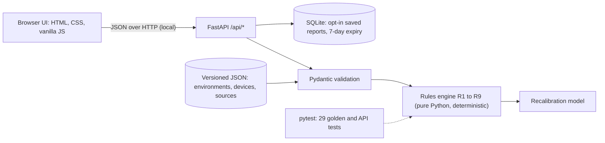

# Bionic Passport

Checks whether medical implants and prostheses will work in space habitats and spacesuits, and what has to change.

Beyond 2030 challenge (IEEE Lumen 2.0). Research prototype for decision support: not medical advice, not a medical device, not a clearance to fly.

## Run it (local, no internet needed)

1. Double-click `run.bat`. It starts the server and opens http://127.0.0.1:8000.
2. Or in PowerShell: `.\run.ps1`, then open http://127.0.0.1:8000.

First-time setup on a new machine:

```
py -3.12 -m venv .venv
.\.venv\Scripts\python -m pip install -r requirements.txt
```

Run the tests: `.\.venv\Scripts\python -m pytest -q` (29 tests).

## The problem

- **The future.** The ISS is planned to retire around 2030 and commercial stations and lunar missions take over. Artemis II flew around the Moon in April 2026.
- **Who is flying.**
  - 2021: Hayley Arceneaux reached orbit with an internal leg prosthesis.
  - 2025: ESA medically cleared John McFall, a lower-limb amputee, for long ISS missions.
  - 2025: Glucose monitors and insulin pens were tested on the ISS.
  - December 2025: Michaela Benthaus became the first wheelchair user in space.
- **What goes wrong.** Medical devices are specified for Earth.
  - Pressure:
    - An insulin pump is rated 70 to 106 kPa.
    - NASA's recommended exploration atmosphere is 56.5 kPa with 34% oxygen.
    - A spacesuit is 29.6 kPa of pure oxygen.
  - Gravity: a powered prosthesis is tuned for 1 g. The Moon gives 0.165 g and Mars 0.38 g.
  - Remote monitoring: it assumes Earth networks, but Mars is 3 to 22 minutes away by light.
- **Why current solutions fail.** Device manuals stop at Earth limits. Commercial spaceflight participants only need informed consent. Today a flight surgeon checks each traveler by hand, from scattered manuals and papers.

## Target users

- Flight surgeons and spaceflight operators' medical teams, who decide.
- Travelers with implants, who need to prepare.
- Device manufacturers, who need to know which tests are missing for space use.

## What we built

- **A compatibility check.** Pick a destination, add devices and see a result per device:
  - Compatible, Needs action, or Not compatible as-is.
  - Every reason, the mitigation, and the source.
- **Evidence marks on every number.** Each one shows whether it is:
  - **F**: an established fact (measured, in a standard or in the manufacturer's manual);
  - **E**: a published estimate;
  - **A**: our assumption;
  - **?**: still to verify against the original document.

  Click any mark to see the citation. Unknown is never shown as compatible.
- **Gravity recalibration for powered prostheses.**
  - Weight-driven stance settings are scaled by `k = ((body mass + f × suit mass) / body mass) × (g / 9.80665)`. Here f is the share of suit weight carried by the legs, from 0 to 1.
  - Swing settings are not scaled, because swing is driven by leg inertia.
  - Example: a 120 N·m push-off on Earth becomes a 19.8 N·m starting value in a lunar habitat. On a lunar EVA it is 19.8 to 43.6 N·m.
- **Compare destinations.** One matrix of devices against five destinations.
- **Methods page.** Every rule, threshold and source.
- **Print view and saved links.** A print view for the flight surgeon. Saved links are opt-in and deleted after 7 days.

Seven device archetypes:
- pacemaker
- ICD
- tubed insulin pump with CGM
- cochlear implant
- microprocessor knee
- powered ankle
- passive internal leg prosthesis

Five destinations:
- orbital station
- lunar habitat
- lunar EVA
- Mars habitat
- Mars EVA

## Architecture



| Part | File |
|---|---|
| API and security headers | `app/main.py` |
| Rules R1 to R9 | `app/engine/rules.py` |
| Thresholds with sources | `app/engine/policy.py` |
| Gravity recalibration model | `app/engine/recalibration.py` |
| Reference data (every value has a source and an evidence level) | `app/data/*.json` |
| Startup check: refuses to run if a value has no source | `app/data_loader.py` |
| Saved reports | `app/storage.py` |
| Interface | `static/` |
| Tests | `tests/` |

The nine rules:

| Rule | Checks |
|---|---|
| R1 | Pressure envelope |
| R2 | Gas expansion in fluid paths |
| R3 | Oxygen-enriched air × battery |
| R4 | Temperature |
| R5 | Radiation total-dose bound and memory upsets |
| R6 | Gravity-dependent functions |
| R7 | Follow-up vs. light delay |
| R8 | Dust |
| R9 | Power and charging |

Full design, sources and reasoning: `BIONIC_PASSPORT_PLAN.md`.

## Why these technologies

| Technology | Why it belongs |
|---|---|
| Python + FastAPI | The engine is arithmetic and rules. Typed endpoints and validation in few lines. |
| Pydantic | Rejects bad input and unsourced reference data. |
| JSON data files | Every value carries its source and evidence level. Changes are reviewable. |
| SQLite | Zero setup. Stores only opt-in saved reports. |
| Vanilla JS, inline SVG chart | No build step and no external downloads. Works offline during the demo. |
| No AI at runtime | No data exists to train or validate a model of device behavior off Earth. The reasoning must be checkable by a clinician. |

## Security and privacy

- **Nothing is stored by default.** Saving is opt-in.
- **Saved reports hold no identity.** They contain device types, settings and findings, with no name or identifiers. Each has a random 128-bit link, expires after 7 days, and can be deleted at once.
- **The server is local.** It binds to 127.0.0.1 only.
- **Strict browser protections.** A Content Security Policy (self only), no third-party scripts or trackers, and no data sent to any external service.
- **Input validation.** All inputs are validated by schema; out-of-range values are rejected.

## Known limitations

- No device was tested in low pressure, pure oxygen or reduced gravity.
- Devices are archetypes from public manufacturer instructions, not specific models.
- Some values are still marked "Verify" (see the Methods page), and the suit-interior temperature is a placeholder.
- Radiation memory upsets are flagged, not quantified.
- The gait model is quasi-static and ignores suit joint torques.
- No clinician has reviewed the rules yet.

## Credits

**Software**

| Component | Use | License |
|---|---|---|
| Python | Runtime | PSF |
| FastAPI | API | MIT |
| Starlette | FastAPI base | BSD-3 |
| Pydantic | Validation | MIT |
| Uvicorn | Server | BSD-3 |
| httpx | Test client | BSD-3 |
| pytest | Tests | MIT |
| SQLite | Storage | Public domain |

**Typeface.** Atkinson Hyperlegible Next, by the Braille Institute, under the SIL Open Font License (`static/fonts/OFL.txt`).

**Data.** Data comes from NASA fact sheets, standards and reports, peer-reviewed papers, and manufacturer instructions for use (Ottobock C-Leg and Empower, Medtronic MiniMed 780G, Cochlear). The full list is on the Methods page and in `app/data/sources.json`. Trademarks belong to their owners.

**AI transparency.** We used Claude (Anthropic) to help plan the product, search the literature and write code. Every numeric value was checked against its linked source or is marked Assumption or Verify. The team reviewed and tested the code. The product uses no AI at runtime.
