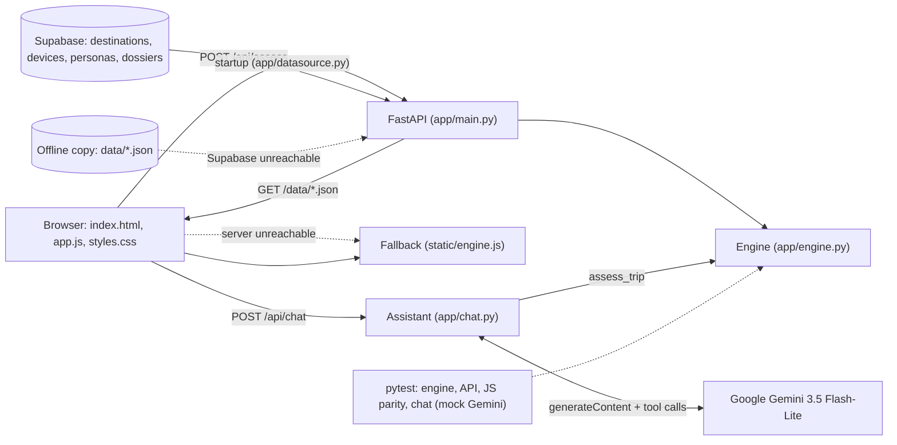

# Bionic Passport

Checks whether a medical implant or prosthesis will work in an orbital habitat, on the Moon or on Mars, and what must change. Beyond 2030 challenge (IEEE Lumen 2.0).

Decision support for travelers and flight surgeons. Not medical advice and not a clearance to fly.

## Run it (local, no internet needed)

- **Windows:** double-click `run.bat`. It starts the server and opens http://127.0.0.1:8000.
- **PowerShell:** `.\run.ps1`, then open http://127.0.0.1:8000.
- **First time on a new machine:**
  ```
  py -3.12 -m venv .venv
  .\.venv\Scripts\python -m pip install -r requirements.txt
  ```
- **Supabase (optional):** copy `.env.example` to `.env` and fill in the project URL and publishable key. The server then reads the catalog from Supabase at startup. Without `.env`, or if Supabase cannot be reached, it uses the offline copy in `data/`. `GET /api/health` reports which one is in use (`data_source`).
- **Assistant (optional):** add `GEMINI_API_KEY` to `.env` and restart the server. `GET /api/health` reports `"chat": true` when it is set. It needs internet; the rest of the app does not.
- **Tests:** `.\.venv\Scripts\python -m pytest -q` (29 tests, always on the offline copy). They need Node.js for the parity test, which is skipped if Node is missing. To check that Supabase holds the same data: `$env:BP_TEST_SUPABASE = "1"; .\.venv\Scripts\python -m pytest -q tests/test_supabase_sync.py`.

## The flow

There is one tab, **Medical Device Configuration**, with three steps and a progress bar at the bottom.

1. **Destination.** Choose Orbital Habitat, Moon or Mars. Each card shows gravity, outside temperature and light delay. Choose a stay length: 1 week, 1 month (default), 6 months or 1 year.
2. **Device.** Choose a powered knee prosthesis, pacemaker, insulin pump or cochlear implant. For the knee only, set body mass.
3. **Result.**
   - A verdict badge: Compatible, Conditional or Not compatible. It always has an icon and a label.
   - One plain sentence.
   - The factors checked, worst first, each with an evidence tag and a source link.
   - What to do.
   - A "with fixes" toggle.
   - For the knee, a torque chart.
   - An instant destination switch and an export (print or PDF).

## Data rules

The catalog lives in Supabase (Postgres), project `bionic-passport`. The server loads it at startup and serves it to the browser as `/data/*.json`, so the browser never talks to Supabase. The files in `data/` are the offline copy, used when Supabase is not configured or unreachable:

| File | Supabase table | Contents |
|---|---|---|
| `data/destinations.json` | `destinations` | Gravity, temperatures, cabin pressure and oxygen, radiation, light delay, dust |
| `data/devices.json` | `devices` | Device limits, decision thresholds (`policy`), mitigations, and the knee torque model |
| `data/personas.json` | `personas` | Demo profiles in the account switcher |
| `data/dossiers.json` | `dossiers` | Saved demo trips, linked to a persona, a destination and a device |

Each table row holds one JSON record unchanged in its `data` column. The other top-level keys of each file (`_readme`, `standard_gravity_ms2`, `policy`) are in `catalog_settings`. The tables are read-only through the Data API: row-level security is on, and the `anon` and `authenticated` roles only have `select`. The schema is in `supabase/schema.sql`.

**Changing data:** edit the file in `data/`, run `.\.venv\Scripts\python scripts\export_supabase_seed.py`, and run the generated `supabase/seed.sql` in the Supabase SQL editor. The seed upserts every record and deletes rows that are no longer in `data/`.

Each value carries an `evidence` level and a `source` (title and URL):

| Evidence level | Meaning |
|---|---|
| Spaceflight data | Measured in space or on the Moon or Mars |
| Aviation data | Measured in aircraft or at airliner cabin pressure |
| Manufacturer spec | From the device's published instructions or specifications |
| Standard | From a standard, regulation or official guideline |
| Research study | From a ground-based study or analysis |
| Physics | Derived from physical laws |
| Team assumption | Our own modeling choice, explained in the note |
| Placeholder | A stand-in value, explained in the note |

- **Placeholders are marked.** Values marked `Placeholder` carry the note "PLACEHOLDER, replace with sourced data". The server refuses to start if a placeholder is not labeled that way.
- **Unchecked sources are marked.** `"verified": false` means the source is real but still needs checking against the original document. The UI shows "to verify".

**Placeholders to replace:**

| File | Field | What it is |
|---|---|---|
| `devices.json` | `torque_model.stance_nm_per_kg` (0.5) | Earth stance torque per kg |
| `devices.json` | `torque_model.swing_nm_per_kg` (0.25) | Earth swing torque per kg |
| `devices.json` | `torque_model.swing_gravity_share` (0.2) | Share of swing torque caused by leg weight |
| `destinations.json` | `orbit.outside_temp_c` (−157 to 121 °C) | Outside temperature in orbit; widely cited, no NASA primary source found |

## API

`POST /api/assess`

Request:

```json
{ "destination_id": "moon", "device_id": "powered_knee", "stay_days": 30, "body_mass_kg": 80, "with_mitigations": false }
```

Response:

```json
{
  "status": "compatible | conditional | not_compatible",
  "summary": "string",
  "factors": [{ "factor": "pressure", "destination_value": "56.5 kPa cabin", "device_limit": "Rated 70 to 106 kPa",
                "status": "conditional", "explanation": "...", "evidence_level": "Manufacturer spec",
                "source": { "title": "...", "url": "..." } }],
  "mitigations": [{ "text": "...", "resolves": ["pressure"] }],
  "mitigated_status": "conditional",
  "recalibration": { "phases": ["stance", "swing"], "earth_nm": [40.0, 20.0], "destination_nm": [6.6, 16.7] }
}
```

Errors:

| Code | Meaning |
|---|---|
| 404 | Unknown destination or device |
| 422 | Input out of range, for example body mass outside the knee's 50 to 116 kg rating |

**Browser fallback.** If the API cannot be reached, the UI computes the same result in the browser with `static/engine.js`, from the same data files. It shows a notice when it does. `tests/test_parity.py` runs both engines on 240 input combinations and requires identical output.

### Passport Assistant: `POST /api/chat`

A chat panel (bottom right) answers questions for the account selected in the top bar, using Google Gemini (`gemini-3.5-flash-lite`). It is optional: without `GEMINI_API_KEY` in `.env` the rest of the app works and the panel says how to set it up.

- **Personalized:** each request names the account (`persona_id`). The server adds that account's profile, its saved trips with their rules-engine results, and the trip open in the app. Other accounts' data is never included.
- **Grounded:** the model cannot reach a verdict itself. It calls tools that run our own code: `assess_trip` (the rules engine), `get_destination` and `get_device` (the catalog). The panel lists the checks behind each answer.
- **Limits:** 20 messages of history, 2,000 characters per message, 20 requests per minute per client, 4 tool rounds per answer. The API key stays on the server.

Request:

```json
{ "persona_id": "alex",
  "messages": [{ "role": "user", "text": "Is my knee OK on the Moon?" }],
  "selection": { "destination_id": "moon", "device_id": "powered_knee", "stay_days": 30, "step": 3 } }
```

Response: `{ "reply": "...", "tools_used": [{ "name": "assess_trip", "args": { ... } }], "model": "gemini-3.5-flash-lite" }`

| Code | Meaning |
|---|---|
| 404 | Unknown account |
| 422 | Invalid history (for example the last message is not from the user, or a message is too long) |
| 429 | More than 20 requests in a minute |
| 502 / 504 | Gemini rejected the key, failed or timed out |
| 503 | `GEMINI_API_KEY` is not set, or the Gemini quota is used up |

## How a result is computed

Seven factors are checked for each device:

| Factor | Rule |
|---|---|
| Gravity | Gravity-dependent functions: knee stance support, pacemaker motion sensor, pump bubble removal |
| Temperature | Cabin temperature vs. the device's operating and charging range, with a 5 °C margin. The outside extremes do not reach worn devices. |
| Air pressure | Cabin pressure vs. the device's rated range. For implants, compared with airliner cabin pressure. For the pump, gas expansion on arrival vs. the 1.36× airliner case. |
| Oxygen | Battery-powered devices in oxygen-enriched air (above 23.5%) |
| Radiation | An upper bound on total dose, with travel included for Mars. Rare memory errors are flagged for life-sustaining devices. |
| Dust | Devices with moving joints or open ports, in bases where dust gets inside |
| Light delay | Need for a specialist or remote monitoring vs. the delay to Earth |

- **Verdict:** the worst factor sets the verdict.
- **With fixes:** a fix either removes a risk ("Fixes") or only lowers it ("Lowers risk"). The "with fixes" status assumes the fixes are done and pass.
- **Knee torque model:** stance torque scales with weight (gravity), and swing torque is mostly inertia. Earth values are placeholders scaled by body mass.

## Architecture



| Technology | Why it belongs |
|---|---|
| Python + FastAPI | Small, typed API. Validation via Pydantic. |
| Supabase (Postgres) | Hosts the catalog. Read-only through the Data API, with row-level security. |
| JSON data files | Offline copy of the catalog, reviewable in git, with evidence and source on every value. |
| Vanilla HTML, CSS, JS | No build step and no external downloads. The font is bundled, so the demo works offline. |
| Node.js (tests only) | Runs the browser engine to prove it matches the server. |
| No user data stored | Supabase holds only the reference catalog and demo data. Assessments are not saved. |
| Google Gemini (assistant only) | Explains results in plain language. Verdicts still come only from the rules engine, so the reasoning stays checkable by a clinician. The account's profile, saved trips and messages are sent to Google. |

## Design brief

| Element | Choice |
|---|---|
| Palette | Neutral background #F5F6F8, white surfaces, ink #172033, one accent #2F55D4 |
| Status colors | Green #17784A, amber #8F5300, red #B42318. Each always paired with an icon and a label. All pass WCAG AA. |
| Typography | Atkinson Hyperlegible Next (Braille Institute, bundled), one family. 18 px base on large screens; the verdict in 2.1 rem bold. |
| Spacing | 8 px grid (8, 16, 24, 32, 40, 48, 64) |
| Shape | 16 px card radius, 12 px controls, subtle two-layer shadows |
| Space theme | Kept to the destination illustrations: calm night panels, no neon |
| Components | Selectable radio cards, segmented controls, switch, status badge, evidence tag, fixed bottom progress bar |
| Motion | Steps fade and rise 8 px in 220 ms. The progress fill takes 260 ms. Presses scale to 0.97. Reduced motion is respected. |
| Chart | Earth in grey as the reference, the destination in the accent, values labeled, hover tooltip, table view |

## 30-second demo walkthrough

1. **Moon card**, keep 1 month, click **Continue**.
2. **Powered knee prosthesis**, leave 80 kg, click **See result**.
   - Point at the badge: Conditional.
   - Point at the sentence and the knee chart: stance drops from 40 to 6.6 N·m, swing barely changes.
3. Click **Mars** in "Change destination". The result recomputes instantly: the light delay row now flags it.
4. Click **Orbital Habitat**. The chart shows that stance support no longer applies in microgravity.
5. Click **Device** in the progress bar, choose **Insulin pump**, then **See result**, then click **Moon** in "Change destination".
   - Turn on **Show status after these fixes**: Conditional becomes **Compatible**.
6. Click **Export report** to show the print-ready page.

## Known limitations

- No device was tested in low pressure, oxygen-rich air or reduced gravity.
- Devices are archetypes based on public manufacturer documents, not specific patients' devices.
- The checks cover life inside a habitat. Spacewalks (pure oxygen at about 30 kPa) are not modeled in this flow.
- The pacemaker is assumed pacing-dependent (worst case).
- Radiation memory errors are flagged, not quantified.
- No clinician has reviewed the rules yet.

## Credits

**Software**

| Component | Use | License |
|---|---|---|
| Python | Runtime | PSF |
| FastAPI | API | MIT |
| Starlette | FastAPI base | BSD-3 |
| Pydantic | Validation | MIT |
| Uvicorn | Server | BSD-3 |
| httpx | Test client | BSD-3 |
| pytest | Tests | MIT |
| Node.js | Tests only | MIT |

**Typeface.** Atkinson Hyperlegible Next, by the Braille Institute, under the SIL Open Font License (`static/fonts/OFL.txt`).

**Illustrations and icons.** Custom SVG, drawn for this project.

**Data sources.** Each value's source is listed in `data/*.json` and linked in the UI. The main ones:
- NASA Moon and Mars fact sheets
- NASA-STD-3001
- NASA Exploration Atmospheres Working Group
- Curiosity RAD (SwRI)
- Chang'E-4 (Zhang et al. 2020)
- Gaier 2005 (Apollo dust)
- King et al. 2011 (insulin pumps at altitude)
- OSHA 29 CFR 1910.146
- AAPM TG-203
- Össur Power Knee instructions
- Medtronic MiniMed 780G specifications
- Donelan and Kram 1997

Trademarks belong to their owners.

**AI transparency.** We used Claude (Anthropic) to help plan the product, search the literature, design the interface and write code. Every numeric value is linked to its source or marked Team assumption or Placeholder. The team reviewed and tested the code. At runtime, AI is used only in the optional Passport Assistant (Google Gemini), which explains results; every verdict comes from the deterministic rules engine.

The earlier multi-device version is archived in `_archive/`.
